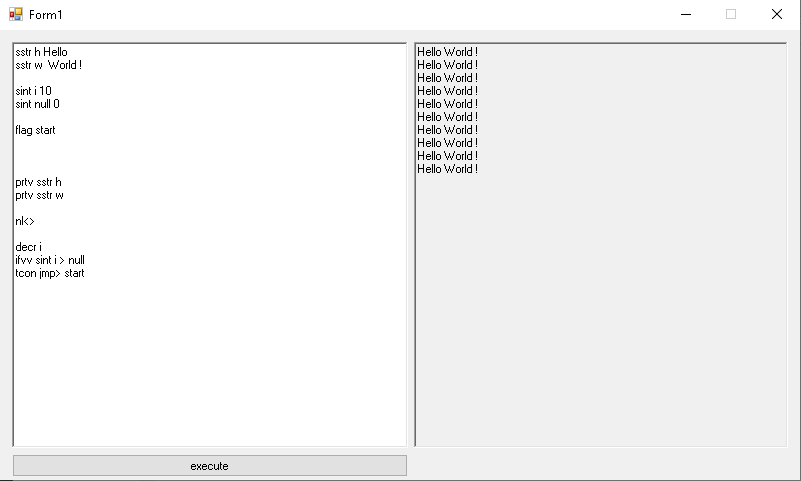

# AgonyScript

[English version](README.md) | **Русская версия**



**AGONYSCRIPT** — это шуточный мини-интерпретатор. Это **не** production-ready язык.
Код специально местами странный, потому что в этом и смысл.

Вдохновлено эзотерическими языками и болью. Особенно Brainfuck.

---

## Что это такое и зачем

- toy language;
- интерпретатор команд из текстового поля;
- WinForms;
- пет-проект. Не ждите ни компилятора, ни спецификации, ни стабильности.

Все команды пишутся с новой строки.
Регистр букв **ВАЖЕН** — и в командах, и в именах переменных.

---

## Основные команды

| Команда | Описание |
|---|---|
| `sstr {имя} {значение}` | Создать строковую переменную. Значение может содержать пробелы и эмодзи. |
| `sint {имя} {значение}` | Создать целочисленную переменную. Значение — только цифры. |
| `prt> {текст}` | Вывести текст в поле вывода (без переноса строки). |
| `prtv sstr {имя}` | Вывести значение строковой переменной. |
| `prtv sint {имя}` | Вывести значение целочисленной переменной. |
| `nl<>` | Перенос строки. **ВАЖНО:** сбрасывает флаг `ifTrue` в FALSE. |

---

## Управление потоком (`ifvv` / `tcon` / `fcon`)

| Команда | Описание |
|---|---|
| `ifvv sstr {имя1} {оператор} {имя2}` | Сравнить две строковые переменные. |
| `ifvv sint {имя1} {оператор} {имя2}` | Сравнить две целочисленные переменные. |

Доступные операторы: `==`, `!=`, `>`, `<`, `>=`, `<=`.
Для `sstr` работают только `==` и `!=`. Для `sint` — все шесть.
Результат сохраняется в глобальный флаг `ifTrue`.

| Команда | Описание |
|---|---|
| `tcon {команда}` | Выполнить `{команду}`, ЕСЛИ `ifTrue == TRUE`. |
| `fcon {команда}` | Выполнить `{команду}`, ЕСЛИ `ifTrue == FALSE`. |

---

## Прыжки и циклы

| Команда | Описание |
|---|---|
| `flag {имя}` | Создать метку (якорь) с именем `{имя}`. |
| `jmp> {имя}` | Безусловный прыжок на метку с именем `{имя}`. |

---

## Интерактив и системные команды

| Команда | Описание |
|---|---|
| `msg> {заголовок} {текст}` | Показать MessageBox с заголовком и текстом. |
| `inp> sstr {имя}` | Открыть окно ввода и записать введённое в строковую переменную. Заголовок окна всегда `"enter value for sstr {имя}"`. |
| `inp> sint {имя}` | Открыть окно ввода и записать число. Заголовок окна всегда `"enter value for sint {имя}"`. |
| `rnd> {имя} {макс}` | Записать в переменную случайное число от 0 до `{макс - 1}`. Если переменная уже была — она перезаписывается. |
| `clr>` | Очистить экран и буфер вывода. Переменные сохраняются. |
| `incr {имя}` | Увеличить целочисленную переменную на 1. |
| `decr {имя}` | Уменьшить целочисленную переменную на 1. |

---

## Известные ограничения (и почему это Agony)

- Все команды и имена переменных **регистрозависимы**.
- Неизвестные команды **молча игнорируются** — опечатка не будет ошибкой.
- `jmp>` **не имеет лимита шагов**: бесконечный цикл повесит форму.
- Ошибки выводятся как `ERROR: ...` **без номера строки**.
- `jmp>` ищет метку через `StartsWith`, поэтому `flag foobar`
  сработает на `jmp> foo`.
- `ifvv` умеет сравнивать только переменную с переменной,
  не с константой.
- Нет комментариев, нет арифметики кроме `incr` / `decr`.
- `clr>` очищает и экран, и буфер вывода; переменные сохраняются.
- `nl<>` сбрасывает `ifTrue` в FALSE — это фича, а не баг.

---

## Как запустить

1. Открыть решение в Visual Studio (WinForms, .NET Framework).
2. Собрать и запустить.
3. Ввести программу в левое текстовое поле и нажать кнопку.

Зависимость: `Microsoft.VisualBasic` (используется `Interaction.InputBox` для `inp>`).
Файлы с примерами должны быть в UTF-8, иначе кириллица сломается.

---

## Пример программы (Угадай число)

```text
rnd> target 10
flag start
inp> sint guess
ifvv sint guess == target
tcon prt> Ты угадал!
tcon jmp> end
fcon prt> Не угадал, попробуй еще!
fcon nl<>
fcon jmp> start
flag end