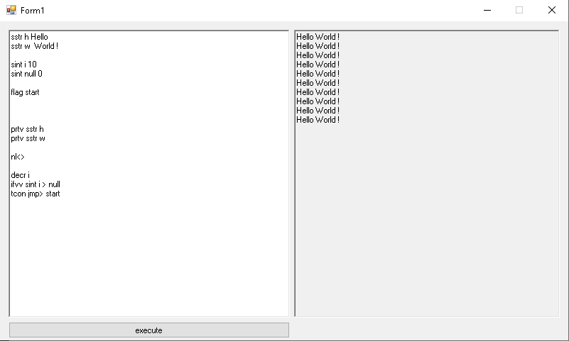

# AgonyScript
[Русская версия](README-ru.md) | **English version**



**AgonyScript** is a joke mini-interpreter for WinForms.
It is **not** a production-ready language. The code is deliberately
weird in places — that's the point.

Inspired by esoteric languages and pain. Especially Brainfuck.

---

## What is this

- a toy language;
- an interpreter for commands typed into a text box;
- WinForms;
- a pet project. Don't expect a compiler, a spec, or stability.

Every command goes on its own line. **Case matters** in both command
names and variable names.

---

## Basic commands

| Command | Description |
|---|---|
| `sstr {name} {value}` | Create a string variable. The value may contain spaces and emoji. |
| `sint {name} {value}` | Create an integer variable. Value is digits only. |
| `prt> {text}` | Print text to the output box (no newline). |
| `prtv sstr {name}` | Print the value of a string variable. |
| `prtv sint {name}` | Print the value of an integer variable. |
| `nl<>` | Print a newline. **Resets the `ifTrue` flag to FALSE.** |

---

## Control flow (`ifvv` / `tcon` / `fcon`)

| Command | Description |
|---|---|
| `ifvv sstr {a} {op} {b}` | Compare two string variables. |
| `ifvv sint {a} {op} {b}` | Compare two integer variables. |

Available operators: `==`, `!=`, `>`, `<`, `>=`, `<=`.
For `sstr` only `==` and `!=` work. For `sint` all six work.
The result is stored in the global `ifTrue` flag.

| Command | Description |
|---|---|
| `tcon {command}` | Execute `{command}` if `ifTrue == TRUE`. |
| `fcon {command}` | Execute `{command}` if `ifTrue == FALSE`. |

---

## Jumps and loops

| Command | Description |
|---|---|
| `flag {name}` | Define a label (anchor) named `{name}`. |
| `jmp> {name}` | Unconditional jump to the label `{name}`. |

---

## Interactive and system commands

| Command | Description |
|---|---|
| `msg> {title} {text}` | Show a MessageBox with a title and text. |
| `inp> sstr {name}` | Open an input box and store the value in a string variable. |
| `inp> sint {name}` | Open an input box and store the value in an integer variable. The window title is always `"enter value for sint {name}"`. |
| `rnd> {name} {max}` | Store a random number in `[0, max - 1]` into the variable. If the variable already exists, it is overwritten. |
| `clr>` | Clear the output screen and the output buffer. Variables are preserved. |
| `incr {name}` | Increment an integer variable by 1. |
| `decr {name}` | Decrement an integer variable by 1. |

---

## Known limitations (and why it's called Agony)

- All commands and variable names are **case-sensitive**.
- Unknown commands are **silently ignored** — a typo is not an error.
- `jmp>` has **no step limit**: an infinite loop will hang the form.
- Errors are printed as `ERROR: ...` **without a line number**.
- `jmp>` looks up labels with `StartsWith`, so `flag foobar`
  will match `jmp> foo`.
- `ifvv` can only compare a variable with a variable, not with a constant.
- There are no comments and no arithmetic other than `incr` / `decr`.
- `clr>` clears both the screen and the output buffer; variables survive.
- `nl<>` resets `ifTrue` to FALSE — this is a feature, not a bug.

---

## How to run

1. Open the solution in Visual Studio (WinForms, .NET Framework).
2. Build and run.
3. Type a program into the program text box and press the button.

Dependency: `Microsoft.VisualBasic` (used via `Interaction.InputBox` for `inp>`).
Example files must be saved as UTF-8, otherwise Cyrillic text breaks.

---

## Example program (Guess the number)

```text
rnd> target 10
flag start
inp> sint guess
ifvv sint guess == target
tcon prt> You guessed it!
tcon jmp> end
fcon prt> Wrong, try again!
fcon nl<>
fcon jmp> start
flag end

## License
MIT. Do what you want.
